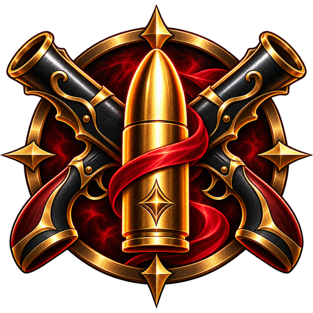
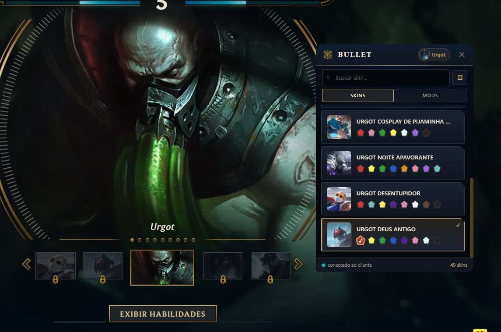

<p align="center">
  
</p>

<h1 align="center">Bullet — League of Legends Skin Changer & Mod Manager</h1>

<p align="center">
  <strong>Open-source League of Legends skin changer, chroma selector, TFT cosmetic unlocker, and custom mod manager (<code>.fantome</code> / <code>.modpkg</code>) for Windows and macOS — written in Rust.</strong><br>
  <em>Your selected skin loads cleanly into every match and game mode.</em>
</p>

<p align="center">
  <a href="https://github.com/Isllanrx/Bullet/actions/workflows/ci.yml"></a>
  <a href="https://scorecard.dev/viewer/?uri=github.com/Isllanrx/Bullet"></a>
  <a href="https://github.com/Isllanrx/Bullet/releases/latest"></a>
  <a href="https://github.com/Isllanrx/Bullet/releases/latest"></a>
  
  
  
  <a href="https://discord.gg/e2dH2nUjd9"></a>
</p>

<p align="center">
  <a href="https://github.com/Isllanrx/Bullet/releases/latest"><b>Download</b></a> ·
  <a href="https://discord.gg/e2dH2nUjd9"><b>Installation Tutorial (Discord)</b></a> ·
  <a href="#quick-install"><b>Quick Install</b></a> ·
  <a href="#features"><b>Features</b></a> ·
  <a href="#faq"><b>FAQ</b></a>
</p>

---

## What Is Bullet?

**Bullet** is a fast, native **League of Legends skin changer** and **custom mod manager** built in **Rust**. It generates official skins, chromas, Exalted forms (`Ctrl+5`), Teamfight Tactics (TFT) cosmetics, and profile identity loadouts directly from your installed game files (`DATA/FINAL/Champions/*.wad.client`) — without modifying Riot's installation, without Pengu Loader, and without requiring administrator privileges on Windows.

<p align="center">
  
  
</p>

> [!IMPORTANT]
> **Full Installation Tutorial:** The complete, step-by-step installation tutorial and setup walkthrough are inside our official Discord server: **[discord.gg/e2dH2nUjd9](https://discord.gg/e2dH2nUjd9)**.

---

## Quick Install

### Windows (10 & 11 x64)

Download [`Bullet-Setup-x64.exe`](https://github.com/Isllanrx/Bullet/releases/latest) or run in **PowerShell**:

```powershell
irm https://raw.githubusercontent.com/Isllanrx/Bullet/main/install.ps1 | iex
```

Or install from source with Cargo:

```powershell
cargo install --git https://github.com/Isllanrx/Bullet.git bullet-app --locked
```

### macOS (Intel `x86_64` & Apple Silicon `M1`–`M4`)

Run in **Terminal**:

```bash
command -v cargo >/dev/null 2>&1 || curl --proto '=https' --tlsv1.2 -sSf https://sh.rustup.rs | sh -s -- -y && source "$HOME/.cargo/env"; cargo install --git https://github.com/Isllanrx/Bullet.git bullet-app --locked && bullet
```

> **macOS In-Client Mode Tip:** Launch League with remote debugging enabled to use the in-client carousel:
> ```bash
> open -a "League of Legends" --args --remote-debugging-port=46359
> ```

### First Launch

1. Follow the full setup walkthrough in our **[Discord server](https://discord.gg/e2dH2nUjd9)**.
2. Open Bullet, sign in with GitHub, and star **[Isllanrx/Bullet](https://github.com/Isllanrx/Bullet)**.
3. Enter Champion Select (or Swiftplay/Brawl Lobby), pick a skin in Bullet's window or directly in the League Client carousel, and play.

---

## Features

- **Every Skin, Chroma & Form (`Ctrl+5`):** Supports 170+ champions and 9,000+ skins & chromas — including **Exalted** (Sahn-Uzal Mordekaiser, Radiant Serpent Sett, Arcane Fractured Jinx), **Hall of Legends**, **Ultimate** skins, companion summons, and localized loading-screen names.
- **Window & Native In-Client Modes:** Switch between Bullet's desktop window and the native in-client carousel (Hextech chroma/form flyout, Swiftplay banner sync, and top-bar **Bullet** menu) with zero external plugins.
- **Customize Identity & TFT Cosmetics:** Unlock Summoner Icons, Borders, Ranked/Event Banners, Titles, and Tokens, plus **TFT** Tacticians, Booms, Portals, and Arenas.
- **Custom Mods (`.fantome`, `.modpkg`, `.zip`):** Import custom skins, maps, HUDs, fonts, and announcers with automatic patch validation and one-click repair in **Support**.
- **Party Mode (E2EE Sync):** End-to-end encrypted (`X25519` + `ChaCha20-Poly1305`) real-time skin and identity sharing with up to 5 friends in your lobby.
- **Every Region & Classic Rift:** Supports all Riot servers (BR, NA, EUW, EUNE, KR, JP, LAN, LAS, OCE, TR, RU, ME, SEA, TW, VN, PBE, WeGame/CN) and Classic Rift (JADE).
- **Safe & Lightweight:** Offline win/loss stats per skin, zero telemetry, standard user (`asInvoker`) on Windows, and available in **English**, **Português (BR)**, and **Español**.

---

## FAQ

### Where is the full installation tutorial?
Inside our official Discord server: **[discord.gg/e2dH2nUjd9](https://discord.gg/e2dH2nUjd9)**.

### Does Bullet modify my League of Legends files?
No. Bullet reads your installed `.wad.client` archives to build a clean slot-0 overlay and applies it in memory at match start. Your Riot Games installation stays 100% untouched.

### Does Bullet require Pengu Loader or Administrator privileges?
No. On Windows, Bullet runs as a standard user (`asInvoker`) and renders the in-client UI directly through League Client APIs without Pengu Loader.

### Which game modes are supported?
Draft Pick, Ranked Solo/Duo, Ranked Flex, Swiftplay, Brawl, ARAM, Arena, Nexus Blitz, TFT, Custom Games, and Practice Tool.

### Can my friends see my skin?
Skins are local by default. Enable **Party Mode** with your friends in Bullet to sync skins, chromas, and profile identity in real time.

---

## Troubleshooting & Building from Source

- Visit **[Discord](https://discord.gg/e2dH2nUjd9)** for setup help, or use **Repair skins and mods** / **Repair client** / **Export diagnostics** under **Support** before opening an [issue](https://github.com/Isllanrx/Bullet/issues).
- Build and test locally:
  ```powershell
  cargo xtask check
  cargo xtask package
  cargo xtask installer
  ```

---

## Disclaimer & License

**Educational project**, provided **as is, without warranty of any kind**, under the [MIT License](LICENSE). Using third-party software with League of Legends violates Riot Games' Terms of Service; use at your own risk. Bullet is not affiliated with or endorsed by Riot Games. See [THIRD-PARTY-NOTICES.md](THIRD-PARTY-NOTICES.md) for dependency notices.
