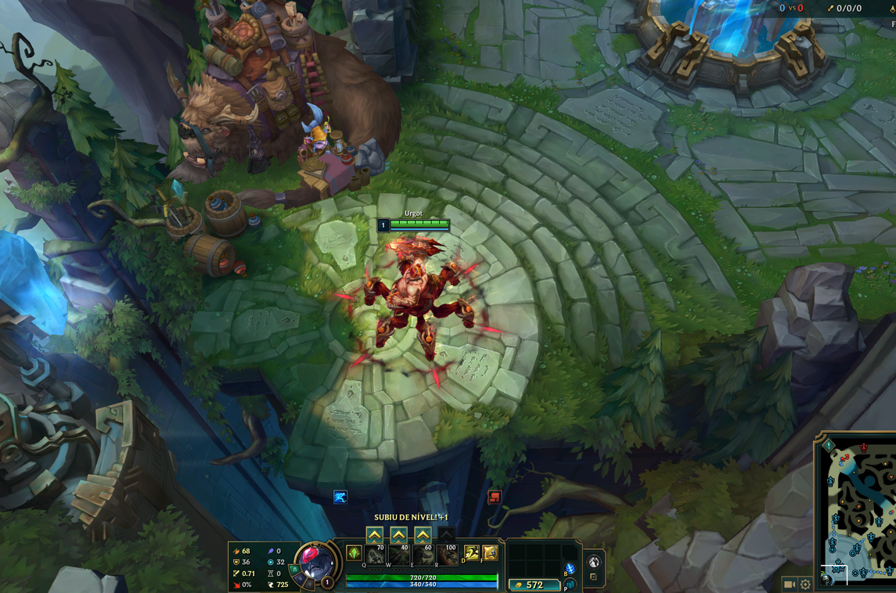

<p align="center">
  
</p>

<h1 align="center">Bullet — League of Legends Skin Changer & Mod Manager</h1>

<p align="center">
  <strong>Open-source League of Legends skin changer, chroma selector, TFT cosmetic unlocker, and custom mod manager (<code>.fantome</code> / <code>.modpkg</code>) for Windows 10 & 11 and macOS (Intel & Apple Silicon) — written in Rust.</strong><br>
  <em>The right skin loads into the match — every mode, every time.</em>
</p>

<p align="center">
  <a href="https://github.com/Isllanrx/Bullet/actions/workflows/ci.yml"></a>
  <a href="https://scorecard.dev/viewer/?uri=github.com/Isllanrx/Bullet"></a>
  <a href="https://github.com/Isllanrx/Bullet/releases/latest"></a>
  <a href="https://github.com/Isllanrx/Bullet/releases/latest"></a>
  
  
  
  <a href="https://discord.gg/e2dH2nUjd9"></a>
</p>

<p align="center">
  <a href="https://github.com/Isllanrx/Bullet/releases/latest"><b>Download Bullet</b></a> ·
  <a href="https://discord.gg/e2dH2nUjd9"><b>Installation Tutorial (Discord)</b></a> ·
  <a href="#how-to-use-bullet"><b>Quick Start Guide</b></a> ·
  <a href="#frequently-asked-questions-faq"><b>FAQ</b></a> ·
  <a href="https://github.com/Isllanrx/Bullet/issues"><b>Report a Bug</b></a>
</p>

---

**Bullet** is a fast, native **League of Legends skin changer** and **LoL custom skin / `.fantome` mod manager** for Windows and macOS. Written in **Rust**, Bullet dynamically generates official League of Legends skins, chromas, Exalted forms (`Ctrl+5`), Teamfight Tactics (TFT) cosmetics, and profile identity loadouts directly from your installed game WAD archives (`DATA/FINAL/Champions/*.wad.client`) — **without modifying your game installation, without administrator privileges on Windows, and without Pengu Loader**.

<p align="center">
  
  
</p>

> [!IMPORTANT]
> **Full step-by-step installation tutorial & support:** Join our official Discord server at **[https://discord.gg/e2dH2nUjd9](https://discord.gg/e2dH2nUjd9)** — the complete installation guide, setup walkthrough, and community support are available inside the Discord server.

> [!NOTE]
> **Educational project**, provided as is, without warranty. The author is not responsible for any damage, account penalty, or loss caused by its use. See the [Disclaimer](#disclaimer).

## How to Use Bullet

> **Need the step-by-step setup guide?** The complete installation tutorial is available inside our **[Discord server](https://discord.gg/e2dH2nUjd9)**.

### Windows (10 & 11 x64)

1. **Download and install Bullet**
   - [Download the latest `Bullet-Setup-x64.exe` installer from GitHub Releases](https://github.com/Isllanrx/Bullet/releases/latest), or install via CLI in **PowerShell**:
     ```powershell
     irm https://raw.githubusercontent.com/Isllanrx/Bullet/main/install.ps1 | iex
     ```
     Or build/install directly with Cargo:
     ```powershell
     cargo install --git https://github.com/Isllanrx/Bullet.git bullet-app --locked
     ```
2. **Follow the installation tutorial on Discord**
   - Check the complete setup instructions inside **[discord.gg/e2dH2nUjd9](https://discord.gg/e2dH2nUjd9)**.
3. **Open Bullet and authenticate**
   - Launch Bullet (no administrator rights needed).
   - Log in with your GitHub account and finish authentication.
   - Visit the Bullet repository and click **Star**: https://github.com/Isllanrx/Bullet
4. **Choose your skin**
   - Open League of Legends and enter Champion Select (Draft, Ranked, ARAM, Custom, Practice Tool, or Swiftplay/Brawl Lobby).
   - Pick your champion and select any skin, chroma, or form in **Bullet's window** or directly inside the **League Client carousel (In-Client mode)**.
   - That's it — your selected skin loads automatically when the match starts.

### macOS (Intel `x86_64` & Apple Silicon `M1` / `M2` / `M3` / `M4`) — Install via CLI

On macOS, Bullet includes a built-in native Mach-O memory patcher (`x86_64` Rosetta 2 and `arm64` Apple Silicon). Run the following command in **Terminal**:

```bash
command -v cargo >/dev/null 2>&1 || curl --proto '=https' --tlsv1.2 -sSf https://sh.rustup.rs | sh -s -- -y && source "$HOME/.cargo/env"; cargo install --git https://github.com/Isllanrx/Bullet.git bullet-app --locked && bullet
```

Or clone and install from a local checkout:

```bash
git clone https://github.com/Isllanrx/Bullet.git
cd Bullet
cargo install --path crates/bullet-app --locked
bullet
```

> **Tip (macOS In-Client Carousel Mode):** To enable Bullet's In-Client carousel directly inside the macOS League Client, launch League of Legends with `--remote-debugging-port=46359`:
> ```bash
> open -a "League of Legends" --args --remote-debugging-port=46359
> ```

Enjoy Bullet!

## Features — LoL Skin Changer & Custom Skin Manager

- **Every League of Legends skin, chroma, and form (`Ctrl+5`)** — supports all 170+ champions and 9,000+ skins & chromas, including **Exalted skins** (Sahn-Uzal Mordekaiser, Radiant Serpent Sett, Arcane Fractured Jinx), **Hall of Legends** (Immortalized Legend Ahri, Kai'Sa), **Ultimate skins** (Elementalist Lux, DJ Sona, Spirit Guard Udyr, Gun Goddess Miss Fortune), companion summons (Tibbers, Daisy, Mega Gnar, Valor, Pix), and localized loading-screen skin names.
- **Two picker modes (Window & Native In-Client)** — switch on the Home tab between **Bullet's desktop window** and **In-Client mode** (native Hextech chroma flyout, Swiftplay banner sync, and top-bar **Bullet** popover with `Home | Mods | Party | Support` — zero Pengu Loader required).
- **Customize Identity & TFT Cosmetics** — unlock Summoner Icons, Borders, Ranked/Event Banners, Titles, and Tokens in the League Client identity customizer (visible to your friends via Party Mode), plus Teamfight Tactics (**TFT**) Tacticians (Little Legends / Chibis), Booms, Portals, and Arenas.
- **Custom mods (`.fantome`, `.modpkg`, `.zip`) & one-click repair** — import custom skins, map skins, HUDs, fonts, and announcer packs verified against the current League patch, with instant one-click skin and client repair in **Support**.
- **Party Mode (Encrypted Skin & Identity Sharing)** — end-to-end encrypted (`X25519` + `ChaCha20-Poly1305`) real-time skin, chroma, and profile identity synchronization with up to 5 friends in your lobby.
- **Every Riot region & server** — works across BR, NA, EUW, EUNE, KR, JP, LAN, LAS, OCE, TR, RU, ME, SEA, TW, VN, PBE, and regional clients (including China / WeGame).
- **Classic Rift (JADE)** — rebuilds legacy champion geometry directly from your installed game WADs.
- **Local skin stats & safe architecture** — offline win/loss and win-rate tracking per skin, zero telemetry, runs as standard user (`asInvoker`), never touches original Riot files, and supports **English**, **Português (BR)**, and **Español**.

## Why Choose Bullet Over Other LoL Skin Changers?

| Capability | Bullet (Rust) | Traditional `.fantome` Managers |
| :--- | :--- | :--- |
| **Built-in Official Skins & Chromas** | Generated on demand from installed game WADs | Manual `.fantome` download per skin |
| **Exalted, Ultimate & Multi-Form Cycling (`Ctrl+5`)** | Native animation graph, submesh, material & Wwise audio switching | Static single-form only |
| **In-Client Carousel & Top-Bar Menu** | Native LCU & Hextech UI without Pengu Loader | External window only |
| **TFT Tacticians, Arenas, Booms & Portals** | Included | Manual mod files only |
| **Customize Identity (Icons, Borders, Banners, Titles)** | Included + synced with Party Mode | Not supported |
| **Custom Mods (`.fantome` / `.modpkg` / `.zip`)** | Automatic patch validation & conflict check | Manual management |
| **Runtime Footprint** | Single native Rust binary (`asInvoker`, no admin) | Varies |

## Frequently Asked Questions (FAQ)

### Where can I find the complete installation tutorial?
The complete step-by-step installation tutorial and troubleshooting guide are inside our official Discord server: **[https://discord.gg/e2dH2nUjd9](https://discord.gg/e2dH2nUjd9)**.

### How does Bullet change League of Legends skins without modifying game files?
Bullet reads the official `.wad.client`, `.bin` (`PROP`), `.skn`, `.skl`, `.anm`, `.tex`, and `.bnk` files already installed in your `League of Legends/Game/DATA/FINAL/Champions` folder, builds a clean slot-0 overlay mod, and applies it in memory at match start. Your original Riot Games installation remains 100% untouched.

### Does Bullet require Pengu Loader or Administrator privileges?
No. On Windows, Bullet runs as a standard user (`asInvoker`) and connects directly to the League Client (LCU) and Chromium DevTools APIs to render the in-client skin carousel, chroma selector, and top-bar **Bullet** popover without installing Pengu Loader.

### Does Bullet work in Swiftplay, ARAM, Arena, and Practice Tool?
Yes. Bullet supports Draft Pick, Ranked Solo/Duo, Ranked Flex, Swiftplay, Brawl, ARAM, Arena, Nexus Blitz, Custom Games, and Practice Tool across every Riot server.

### Can my friends see my skin in League of Legends?
Skin overlays are local to your machine by default. When you and your friends enable **Party Mode** inside Bullet, your selected skins, chromas, and profile identity (icons, borders, banners, titles, tokens) are automatically synchronized and rendered across everyone in your Bullet Party.

## Troubleshooting

- Check the installation & troubleshooting channels inside our **[Discord server](https://discord.gg/e2dH2nUjd9)**.
- Run **Repair skins and mods** or **Repair client** in **Support** if a game patch or custom mod breaks.
- Click **Export diagnostics** in **Support** (`%LOCALAPPDATA%\Bullet\logs`) before opening an [issue](https://github.com/Isllanrx/Bullet/issues) or asking on [Discord](https://discord.gg/e2dH2nUjd9).
- Close other skin tools while Bullet is running to avoid overlay hook conflicts.

## Building from Source

```powershell
cargo xtask check
cargo xtask package
cargo xtask installer
```

## Acknowledgements

Built in Rust by **Isllan Toso** — [isllan.dev](https://isllan.dev/). See [THIRD-PARTY-NOTICES.md](THIRD-PARTY-NOTICES.md) for open-source dependency notices.

## Disclaimer

Bullet is published **for educational purposes**, **as is, without warranty of any kind**, under the MIT license. Using third-party software with League of Legends violates Riot Games' Terms of Service; you use it at your own risk. Bullet only changes visuals locally on your machine and is not affiliated with or endorsed by Riot Games. League of Legends and Teamfight Tactics are trademarks of Riot Games, Inc.

## License

- **Source Code:** [MIT License](LICENSE)
- **Third-Party Components:** [THIRD-PARTY-NOTICES.md](THIRD-PARTY-NOTICES.md)
